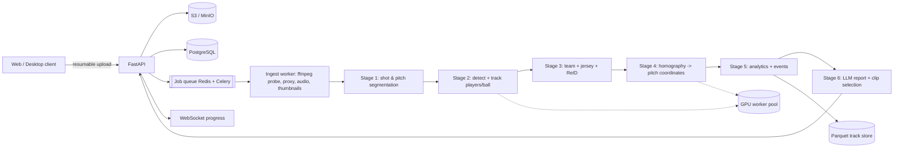

# FieldWizard — Product & Engineering Plan

**One-liner:** Upload any football footage — a phone clip or a full 90-minute broadcast — and get player tracking, jersey-number identification, tactical analytics, and a coach-grade report with timestamped video evidence.

**Status:** Planning draft v1 · Oct 2026

---

## 1. Vision & positioning

Most serious video analytics require a special panoramic camera (Veo, Pixellot, Hudl Focus). Most clubs and academies already have *footage* — broadcast, a phone on a tripod, a fixed wide-angle cam — and no way to turn it into data.

FieldWizard's wedge:

> **"Any footage in, pro-level analysis out."**

- No proprietary hardware required.
- Works on a 2-minute clip today, scales to a full match tomorrow.
- Output is not just numbers — it is *coaching decisions* with video evidence.
- The dashboard should feel like FIFA/Football Manager: beautiful, legible, shareable.

**Non-goals for v1:** live real-time analysis, multi-camera fusion, betting/odds, medical diagnosis, automated refereeing.

---

## 2. Who it is for

| User | Job to be done | What they value |
|---|---|---|
| Academy / semi-pro coach | "Why did we lose the midfield?" | Fast, trustworthy tactical insight + clips to show players |
| Analyst (1-person dept) | Replace 6 hours of manual tagging | Accurate tracking, exportable data, low correction effort |
| Player | "How did I play, what do I improve?" | Personal dashboard, heatmap, clips, rating |
| Scout / parent | Compare players, track development | Longitudinal trends, shareable reports |
| Club director | Justify decisions | Team-level trends, PDF reports |

Primary ICP for launch: **one analyst or coach at a club with existing video**, not a Premier League data department.

---

## 3. Product principles

1. **Evidence or it didn't happen.** Every insight links to a timestamp and a clip.
2. **Never silently wrong.** Confidence is surfaced; low-confidence tracks are visually flagged and editable.
3. **Progressive trust.** Start with automatic results; let the user fix IDs/numbers; corrections propagate to analytics.
4. **Fast first value.** A 2-minute clip should produce a dashboard in minutes, not hours.
5. **The report is the product.** Numbers are table stakes; the LLM narrative + clips is the differentiator.
6. **Boring infrastructure.** Idempotent, resumable, versioned. A 90-minute job must survive a crash.

---

## 4. Feature scope

### 4.1 MVP (clip mode, ≤ 5 minutes)

- Upload MP4/MOV, resumable, up to 4 GB.
- Auto-detect: players, goalkeepers, referees, ball.
- Persistent IDs within a shot; team classification (Team A / Team B / Referee / GK).
- Jersey number recognition with **roster-constrained voting**.
- Pitch registration → real-world coordinates (metres).
- Per-player: distance, top speed, sprints, average position, heatmap, touch map.
- Team: possession %, heatmap, average shape, compactness, passing network (basic).
- Ball tracking + possession timeline.
- Dashboard: match page, team page, player page; video player with overlays.
- LLM report v1: 1-page summary, 5 strengths, 5 issues, 5 recommendations, each with clips.
- Export: PDF, MP4 overlay, CSV.

### 4.2 v1 (full match)

- 90+ min processing with chunking, checkpointing, resume.
- Substitutions, red cards, half-time, stoppage-time segmentation.
- Re-identification across broadcast camera cuts.
- Event detection: goals, shots, corners, throw-ins, kickoffs, turnovers.
- Highlights auto-generated; coach can trim/keep clips.
- Pass/shot/turnover maps, pressure maps, line-breaking passes, progressive passes.
- Formation detection + phase-based shape (in possession / out of possession).
- Player ratings (position-normalized), team ratings.
- Manual correction UI for IDs and jersey numbers.
- Multi-user orgs, roles, share links.

### 4.3 v2 (platform)

- Multi-match longitudinal player development, load monitoring (ACWR), scouting shortlists.
- Opponent scouting reports and comparison.
- Set-piece analysis, offside line estimates, xT/xG estimates.
- Voice/natural-language Q&A over a match ("show every turnover in our defensive third").
- Live/stream ingestion (RTSP) with 30–60 s latency.
- On-prem/desktop mode for privacy-sensitive clubs.
- API + webhooks for integrations.

### 4.4 Deliberate omissions (until validated)

- Multi-camera 3D reconstruction.
- Fully automatic event detection without scoreboard/event data (too brittle early).
- Real-time in-match tactical alerts.
- Referee decision analysis.

---

## 5. Hard technical truths (read this before promising "perfect")

Single-camera football tracking is a genuinely hard CV problem. What is realistic:

| Capability | Realistic v1 accuracy | Why |
|---|---|---|
| Player detection (wide shot) | 95–99% recall | Mature models |
| Tracking ID retention within a shot | 85–95% | Occlusion + crowding |
| Tracking across camera cuts | 70–90% | Requires ReID + pitch gating |
| Team assignment | 97–99% | Kit colour clustering is easy |
| Jersey number (track-level, roster-constrained) | 80–92% | Blur, distance, folded numbers |
| Pitch homography (wide shot) | 0.5–2 m error | Line detection + smoothing |
| Ball detection (wide shot) | 85–95% | Tiny object, motion blur |
| Possession | ±3–5% vs manual | Depends on touch detection |
| Pass/turnover events | F1 0.7–0.85 | Needs ball + player proximity |
| Distance covered per player | ±3–5% | Projection noise |

Implications:

- **Close-ups, replays, crowd shots have no pitch** — the pipeline must detect "analysable" vs "non-analysable" frames and never invent data there.
- **Jersey OCR is not frame-by-frame.** It is per-track, multi-frame, confidence-weighted voting constrained to the declared roster. This one design choice is worth ~20 points of accuracy.
- **"Perfect" is achieved with human-in-the-loop**, not by model alone: a 60-second correction pass per match gets you to near-ground-truth.
- **Fixed wide-angle / panoramic footage is 2–3× more accurate than broadcast.** Support both, and onboard users toward the best setup (tripod, elevated, whole pitch in frame).

---

## 6. System architecture



**Design rules**

- Every stage reads/writes immutable artifacts keyed by `(match_id, stage, pipeline_version)`.
- Stages are idempotent and individually re-runnable (e.g., re-run jersey OCR after roster edit without re-tracking).
- Heavy data lives in Parquet/object storage; Postgres holds metadata, events, metrics, reports.
- GPU workers are stateless; all state is checkpointed to object storage.
- The frontend never talks to GPU workers directly; it polls/subscribes to job state.

---

## 7. CV / ML pipeline deep dive

### 7.1 Ingest

- `ffprobe` → fps, resolution, duration, rotation, audio.
- Proxy: 720p H.264 for the web player + frame-accurate timebase.
- Analysis copy: keep original resolution; decode on GPU (NVDEC) when available.
- Split into 5-minute analysis chunks **with 10 s overlap**; chunk boundaries are stitched later using track state + ReID.
- Normalize: 25 fps target (detect at 12.5 fps, ball at 25 fps).

### 7.2 Shot segmentation & playability

- Classify each frame: `wide`, `medium`, `close_up`, `replay`, `crowd`, `graphic`.
- Use a lightweight classifier (ResNet/EfficientNet fine-tuned) + pitch-visibility heuristic (number of detected pitch lines/keypoints).
- Output a `playable_mask`; analytics only run on playable frames. This prevents garbage heatmaps and fake sprints during replays.
- Detect camera cuts (histogram + embedding distance) to reset tracker state and trigger ReID.

### 7.3 Pitch registration (the foundation of everything)

Two modes:

1. **Fixed camera** — one homography for the whole match, estimated from the first clean frame and refined.
2. **Broadcast / panning** — per-frame homography.

Approach:

- Keypoint model for pitch landmarks (penalty spots, box corners, centre circle intersections, touchline intersections). Train on SoccerNet calibration + synthetic homographies.
- Robust homography via RANSAC on ≥4 correspondences; temporal smoothing (Kalman on camera pose, or homography interpolation over ±5 frames).
- Sanity checks: reprojection error, plausible focal length, pitch polygon inside image, scale consistency.
- When <4 reliable points (close-up, replay): mark frame unplayable and interpolate player positions only for short gaps (<1 s) using velocity.
- Store homography per frame + confidence; expose pitch-space transforms to the frontend so overlays stay aligned.

Optional accelerators: line-segment detection (DeepLine) + template matching for night/poor-light games; manual 4-point calibration fallback in the UI (click the 4 penalty-area corners) — always ship a manual escape hatch.

### 7.4 Detection

- Players/refs/GK: YOLOv8/v11-s or RF-DETR fine-tuned on SoccerNet + SportsMOT + own labels. Classes: `player`, `goalkeeper`, `referee`, `staff`, `ball`.
- Inference at 960×540 with tiling for far-side small players; confidence threshold tuned per zone (far touchline is harder).
- Ball: dedicated small-object detector at higher resolution on a crop around the predicted ball location (temporal ROI), plus a TrackNet-style heatmap model over 8-frame windows. Fusion of both.
- Batch frames (8–16) in FP16; export to TensorRT for production.

### 7.5 Tracking

- **BoT-SORT / ByteTrack** with:
  - Camera-motion compensation using the pitch homography (not just sparse optical flow) — critical for broadcast pans.
  - Appearance embeddings (OSNet / CLIP-ReID) for re-association after occlusion.
  - Sports-tuned association (Deep-EIoU-style) with a longer track buffer.
- Track lifecycle: tentative → confirmed → lost → removed; lost tracks kept in a gallery for 30–60 s for re-entry.
- **Cross-cut ReID:** after a cut, match new detections to the pre-cut roster of active players using (a) appearance, (b) last known pitch position + elapsed time feasibility, (c) team, (d) jersey number when available. Use Hungarian assignment with a cost matrix; reject implausible jumps (> 12 m/s).
- **Substitution handling:** new track with same team + different number; if number is unknown, require a bench event or manual confirmation.

### 7.6 Team & role classification

- Crop torso region (upper 40% of bbox), compute colour histogram in Lab + dominant colour clustering.
- K-means (k=4: Team A, Team B, GK A, GK B) + referee cluster (usually black/yellow, detected by distinct colour + central positioning).
- Per-track majority vote over its lifetime; smooth with temporal hysteresis.
- Handle kit clashes (both teams similar colour) by spatial prior (teams occupy opposite halves at kickoff) and manual override.

### 7.7 Jersey number recognition

This is a **track-level classification problem**, not OCR-per-frame:

1. Collect 20–80 torso crops per track where crop height ≥ 40 px and blur score is acceptable.
2. Run a number recogniser (PARSeq/SVTR fine-tuned on SoccerNet jersey numbers; digits 1–99).
3. Weight votes by crop quality (size, sharpness, detector confidence, OCR confidence).
4. **Constrain to the declared roster** for that team (numbers 1–99, GK numbers known). This turns an open-set OCR problem into a closed-set matching problem and is the single biggest accuracy lever.
5. If the top-2 candidates are close, mark `uncertain` and surface it in the correction UI (one click to confirm).
6. Re-run instantly after roster edits — no re-tracking needed.

### 7.8 Analytics layer

All analytics run on pitch coordinates, in-play frames only.

**Player**

- Distance (m), distance/min, top speed, avg speed, sprint count (> 25.2 km/h), high-intensity runs (> 19.8 km/h), accelerations/decelerations, player load (sum of |accel|), max speed duration.
- Average position, positional heatmap (2D KDE), touch map, pass receive map, off-ball run count.
- Involvement: touches, passes attempted/completed, key passes, progressive passes, line-breaking passes, carries, turnovers, duels (proximity + ball contest), pressures applied.
- Minutes played, substitution windows.

**Team**

- Possession % (time-based, not pass-count-based), time in thirds, time in final third, entries into box.
- Shape: centroid, width, depth, compactness (std dev / convex hull area), defensive line height, pressing height.
- Pass network (nodes = avg positions, edges = completed passes), centrality.
- PPDA-proxy (needs pass detection; label as estimated), turnovers by zone, regain locations, transition speed.
- Momentum graph (rolling xT/threat delta or territory + shot proxy).
- Set-piece vs open-play split (v2).

**Match**

- Score timeline, possession timeline, shot/attack timeline, key events with clips, phase segmentation (in-play / stoppage / half-time).

**Ratings**

- Per-position z-scores against a cohort (start with public data + your own matches; grow over time).
- Weighted composite → 0–10 "FieldWizard Rating". Publish the formula and label it proprietary/estimated. Never present it as an official metric.

### 7.9 Event detection (v1)

- **Goal:** ball crosses goal line between posts + restart pattern; confirm with scoreboard OCR if available.
- **Shot:** ball velocity toward goal + trajectory within frame + origin in attacking third.
- **Corner / throw-in / goal kick:** ball out of play + restart location.
- **Kickoff / half-time:** formation reset + centre spot.
- **Turnover:** possession change event.
- **Pass:** touch by A → ball flight → touch by B (same team) within a plausible time window.
- **Touch:** ball within 1.2 m of a player and ball speed changes, or sustained proximity.
- **Possession:** nearest player within 2 m for ≥ 3 consecutive frames; team-level possession chains.

Every event stores `start_frame`, `end_frame`, `confidence`, and `evidence` (track IDs, ball positions). Low-confidence events are hidden by default and shown in a "review" queue.

---

## 8. Data model (core)

```sql
matches(id, org_id, title, source_uri, proxy_uri, fps, width, height,
        duration_s, status, pipeline_version, created_at, processed_at)

match_teams(match_id, side, name, colour_primary, colour_secondary, formation)

players(id, org_id, team_id, name, shirt_number, position, dob)
match_rosters(match_id, player_id, team_side, shirt_number, is_starter)

tracks            -- Parquet, partitioned by match_id/half
  match_id, frame, ts, track_id, cls, team, jersey, jersey_conf,
  x1,y1,x2,y2, pitch_x, pitch_y, speed, conf, playable

events(id, match_id, ts_start, ts_end, type, team_side, track_id,
       confidence, attrs jsonb, clip_uri)

player_metrics(match_id, track_id, player_id, minutes, distance_m, sprints, ...)
team_metrics(match_id, team_side, possession_pct, compactness, ...)

reports(id, match_id, kind, llm_model, prompt_version, content jsonb, created_at)
corrections(id, match_id, target_type, target_id, before, after, user_id, ts)
```

**Storage sizing (90 min, 1080p):** original 4–10 GB, proxy 0.8–1.5 GB, frames not stored (only crops on demand), tracks Parquet 50–200 MB, thumbnails 50–150 MB, clips 0.5–1 GB. Budget ~12–15 GB per match; tier to cold storage after 90 days.

---

## 9. LLM analysis engine

### 9.1 Principle

The LLM never watches raw video by default and never invents numbers. It reasons over a **compact, verified fact sheet** and cites evidence.

### 9.2 Pipeline

1. **Fact sheet builder** (deterministic Python): match meta, team metrics, player table, top 30–50 events with timestamps, phase summaries, notable outliers (e.g., "RB lost possession 9× in own half").
2. **Retrieval**: club philosophy / coaching principles / drill library (RAG) so advice fits the club's style.
3. **Agent** with tools: `get_metrics`, `get_events`, `get_clip`, `compare_players`, `get_heatmap_stats`.
4. **Structured output** (JSON schema):
   ```json
   {
     "summary": "...",
     "findings": [{
       "claim": "...",
       "evidence": [{"event_id": "...", "ts": "34:12", "clip": "..."}],
       "confidence": "high|medium|low",
       "impact": "high|medium|low",
       "recommendation": "...",
       "drill": "..."
     }],
     "limitations": ["..."]
   }
   ```
5. **Verification pass**: recompute every numeric claim against the fact sheet; drop or rewrite failures. Enforce "insufficient data" when sample size is small.
6. **Render** into the report UI with clickable clips.

### 9.3 Vision-LLM (selective, v1.5)

- Only for flagged moments (goals conceded, big chances, pressing breakdowns).
- Send 8–16 frames + tracking overlay + numeric context, ask a constrained question ("what defensive error enabled this chance?").
- Cache by clip hash; cost-capped per match.
- Never let VLM output override tracked facts; it only adds qualitative description.

### 9.4 Cost & quality controls

- Hierarchical summarisation for full matches (per 15-min window → half → match).
- Prompt caching for the static fact sheet; JSON mode; temperature 0.2.
- Provider-agnostic gateway (LiteLLM) — swap GPT/Claude/Gemini; local Qwen/Gemma for on-prem tier.
- Prompt versioning + eval set of 20 match reports scored by coaches (usefulness, accuracy, actionability).
- Deterministic template fallback: if the LLM fails, the report still renders with rule-based insights.

---

## 10. Dashboard & UX

### 10.1 Information architecture

- **Matches** → list, upload, processing status.
- **Match** → score header, timeline, possession, momentum, key events, report.
- **Team** → formation pitch, XI cards, team stats, heatmap, pass network, phases.
- **Player** → rating card, radar vs positional average, heatmap, sprint/touch maps, clips, trend.
- **Report** → narrative + evidence clips, export.
- **Review** → low-confidence tracks/events/jerseys for human correction.

### 10.2 Visual language (the "FIFA" feel)

- Dark pitch-green/charcoal theme, glassmorphism panels, subtle motion.
- Formation view: pitch with player tokens, shirt number, rating badge, drag to compare.
- Player card: large rating, 6-axis radar (attacking, passing, defending, physical, positioning, involvement), heatmap thumbnail.
- Team page: attack/mid/def/overall ratings, possession donut, momentum area chart, pass network.
- Heatmaps: smooth KDE gradients on a real pitch, toggle player/team, normalized per 90.
- Video: synchronized overlay canvas (bboxes, IDs, trails, ball), click a player to filter all charts, clip-to-chart linking.
- Everything shareable as a public link with watermark/expiry.

### 10.3 Trust UX

- Confidence badges on every metric; "estimated" tooltips explaining method.
- Review queue count on the match page ("12 items need confirmation").
- One-click corrections; analytics recompute in seconds.
- "How this was calculated" panel per metric.

---

## 11. Scale & robustness for 90+ minutes

### 11.1 Job orchestration

- Celery + Redis (or Dramatiq) with per-stage tasks, retries with backoff, idempotency keys.
- Checkpoint every 1,000 frames: tracker state, last frame, partial Parquet shard.
- Resume from last checkpoint on worker failure; never restart from zero.
- Progress: per-stage %, ETA from measured throughput; WebSocket push.
- GPU queue separate from CPU queue; concurrency = 1 job per GPU.
- Dead-letter queue + admin re-run UI; structured logs with `match_id`/`stage`.

### 11.2 Throughput reality check

90 min @ 25 fps = **135,000 frames**.

| Hardware | Detection (FP16, 960px) | Full pipeline (effective) | 90-min match |
|---|---|---|---|
| RTX 3050 Laptop 4 GB | ~40–60 FPS | ~8–15 FPS | **3–6 h** (thermal throttling likely) |
| RTX 4090 24 GB | ~200+ FPS | ~40–60 FPS | 40–60 min |
| L4 / A10 24 GB (cloud) | ~120 FPS | ~25–35 FPS | 60–90 min |
| TensorRT + 12.5 fps detect | — | 2× faster | 30–45 min on L4 |

**Plan:** develop on the 3050 with 2–5 min clips; run full matches on cloud GPU burst. Don't promise full-match turnaround on laptop hardware.

### 11.3 Optimizations

- Decode with NVDEC; avoid Python per-frame loops (batch + pinned memory).
- Detect every 2nd frame; interpolate boxes; ball at full rate.
- OCR only on high-quality crops; cache per track.
- Parquet columnar output, no per-frame JSON.
- Downscale far-side ROI only; tile near/far halves separately.
- Precompute heatmaps/aggregates once per match, not per page load.

### 11.4 Reliability targets

- 99% of jobs complete without manual intervention (after retries).
- Crash-resume loses < 60 s of work.
- Deterministic outputs for the same pipeline version + input (seed everything).
- Model/pipeline version stamped on every artifact; one-click re-run with a new version.

---

## 12. Evaluation & QA

Build the eval harness **before** the dashboard.

**Golden set:** 3 clips × 3 conditions (broadcast wide, broadcast tight/panning, fixed wide-angle), 2–3 min each, manually annotated at 5 fps: boxes, IDs, team, jersey, pitch coordinates, possession, passes, shots.

**Metrics per release:**

| Area | Metric | MVP target | v1 target |
|---|---|---|---|
| Detection | mAP@0.5 | 0.90 | 0.95 |
| Tracking | HOTA / IDF1 | 55 / 65 | 70 / 78 |
| ID switches | per player per 10 min | < 4 | < 2 |
| Jersey | track-level accuracy | 80% | 90% |
| Calibration | median reprojection error | < 2.0 m | < 1.0 m |
| Possession | abs error vs manual | < 7% | < 4% |
| Passes | F1 | 0.65 | 0.80 |
| Events | F1 (shots/goals/corners) | 0.70 | 0.85 |
| Distance | error vs manual | < 8% | < 5% |
| LLM report | coach usefulness (1–5) | 3.5 | 4.2 |
| LLM report | unsupported-claim rate | < 5% | < 2% |
| Pipeline | 90-min job success | — | > 98% |

Also track **correction time**: minutes a human needs to fix a match. Target < 5 min for v1. This is the real product-quality metric.

---

## 13. Data & model strategy

**Public datasets to bootstrap**

- SoccerNet: tracking, jersey numbers, calibration, game state, action spotting.
- SkillCorner open data: broadcast tracking with ground truth for validation.
- StatsBomb open data: event/xy data for analytics validation (not tracking).
- SportsMOT / MOT20: generic multi-object tracking pretraining.
- DeepSportradar: jersey number recognition.
- Synthetic homographies from pitch templates for calibration robustness.

**Training loop**

1. Start with pretrained weights; fine-tune on SoccerNet + 2–3 of your own matches.
2. Active learning: sample low-confidence frames/crops from production; annotate in CVAT/Label Studio (or a lightweight in-house tool).
3. Track-level labels (jersey, team) are cheaper than frame-level boxes — prioritise them.
4. Keep a frozen eval set; never train on it.
5. Model registry (MLflow or simple S3 + manifest) with version, metrics, and data hash.

**Annotation budget (rough):** 2,000 frames boxes+IDs (~40 h), 5,000 jersey crops (~15 h), 1,000 calibration frames (~10 h), 3 matches of analytics ground truth (~30 h). Outsource box labeling; do analytics labels in-house with the coach.

---

## 14. Tech stack

| Layer | Choice | Why |
|---|---|---|
| Frontend | Next.js 15 + TypeScript, Tailwind, shadcn/ui | Fast iteration, great dashboards |
| Charts | Recharts + D3 (pitch), canvas overlays | Custom pitch visuals need D3/canvas |
| Video | hls.js / Video.js + canvas overlay layer | Frame-accurate, seekable |
| API | FastAPI + Pydantic | Python-native, async, OpenAPI |
| DB | PostgreSQL 16 (+ pgvector for RAG) | Reliable; pgvector avoids extra infra |
| Queue | Redis + Celery | Boring and sufficient |
| Object store | S3 (prod) / MinIO (dev) | Resumable uploads, lifecycle rules |
| CV | PyTorch, Ultralytics, OpenCV, supervision, filterpy | Standard, fast to ship |
| Tracking | BoT-SORT/ByteTrack + OSNet ReID | Proven in sports |
| OCR | PARSeq/SVTR fine-tuned | Strong on jersey digits |
| Analytics | pandas/Polars, numpy, scipy | Parquet-friendly |
| LLM | LiteLLM gateway (GPT/Claude/Gemini) + local option | Provider flexibility |
| Observability | OpenTelemetry, Sentry, Langfuse (LLM traces) | Debug quality and cost |
| Infra | Docker Compose (dev) → Fly/Render + RunPod/Modal GPU (prod) | Cheap to start, burst GPU |

**Repo layout (monorepo)**

```
apps/web                 Next.js dashboard
apps/api                 FastAPI
services/pipeline        CV stages, CLI runner
services/analytics       metrics + events
services/llm             fact sheet, agent, prompts, evals
packages/schema          shared JSON schemas / TS types
infra/                   docker, migrations, deploy
evals/                   golden set, notebooks, metrics
docs/                    this plan, ADRs
```

---

## 15. Roadmap

Effort in person-weeks (pw). Solo full-time ≈ 30–36 pw to a solid v1; a 3-person team ≈ 3–4 months.

### Phase 0 — Foundations (1–2 pw)

- Monorepo, CI, Docker Compose, Postgres, MinIO, Redis.
- Upload + ffmpeg proxy + job queue + progress UI.
- Golden-set harness skeleton + 3 annotated clips.
- **Exit:** upload a clip, see it processed into a proxy and a placeholder dashboard.

### Phase 1 — MVP clip analytics (6–8 pw)

- Detection + tracking + team classification.
- Pitch homography (fixed + basic broadcast) with confidence gating.
- Jersey OCR with roster constraint + review UI.
- Player/team metrics, heatmaps, possession, basic pass network.
- Dashboard v1 (match, team, player) + video overlays.
- **Exit:** 2-min clip → dashboard in < 10 min on laptop; jersey ≥ 80%, possession ±7%.

### Phase 2 — Full match (5–7 pw)

- Chunked processing, checkpoints, resume, retries.
- Camera-cut handling + cross-cut ReID; substitutions.
- Event detection v1 + clips; highlights.
- Report PDF export; share links.
- **Exit:** 90-min match completes unattended; < 5 min human correction; > 98% job success.

### Phase 3 — LLM analyst (3–4 pw)

- Fact sheet, structured report, verification pass, evidence clips.
- Coaching RAG + drill recommendations.
- Selective VLM clip analysis.
- Report eval with 3 coaches; prompt/version tracking.
- **Exit:** coach-rated usefulness ≥ 4/5; unsupported claims < 2%.

### Phase 4 — Polish & differentiation (4–6 pw)

- FIFA-style team/player cards, radar, momentum, pass networks, animations.
- Natural-language Q&A over match data.
- Multi-match trends, load monitoring, scouting shortlist.
- Performance hardening, cost reduction (TensorRT, caching).

### Phase 5 — Platform (6–8 pw)

- Orgs/roles/billing, API, webhooks.
- On-prem/desktop packaging.
- Live stream ingestion (experimental).

**Suggested first 6 weeks (solo):**

| Week | Deliverable |
|---|---|
| 1 | Repo, upload, ffmpeg, queue, DB schema, golden clips selected |
| 2 | Detection + tracking running on a clip, overlay player |
| 3 | Pitch homography + pitch-space overlay; playable-frame mask |
| 4 | Team classification + jersey voting + roster constraint |
| 5 | Metrics + heatmaps + possession; Parquet pipeline |
| 6 | Dashboard v1 + LLM report v1 + internal demo |

---

## 16. Risks & mitigations

| Risk | Impact | Mitigation |
|---|---|---|
| Ball tracking fails in crowded box | Possession/pass metrics degrade | Temporal model + ROI + confidence gating; fall back to proximity-based possession |
| Homography drift on pan/zoom | Coordinates wrong | Per-frame estimation + smoothing + sanity checks; manual 4-point fallback |
| Jersey OCR unreliable at distance | Player identity wrong | Track-level voting + roster constraint + review UI |
| ID switches after occlusion | Wrong player metrics | ReID gallery, pitch gating, correction UI, confidence flags |
| Broadcast cuts/replays | Gaps in data | Playability mask; never impute beyond 1 s; report coverage % |
| LLM hallucination | Trust collapse | Fact-sheet-only prompting, citation requirement, verification pass, limitations section |
| 90-min job crashes | Lost hours | Checkpoint/resume, chunking, idempotent stages |
| GPU cost | Margin | TensorRT, frame skipping, spot instances, cache by content hash |
| Legal/privacy | Blocked sales | Footage rights attestation, consent for minors, retention controls, on-prem option |
| Scope creep | Never ships | Clip-first milestone; freeze MVP feature list |

---

## 17. Cost model (indicative)

**Per 90-min match (cloud, small scale)**

- GPU: 0.75–1.5 h on L4 @ ~$0.5–0.8/h → **$0.40–1.20**
- LLM report: **$0.05–0.30** (text) + $0.30–1.50 if VLM clips used
- Storage: ~12 GB → **$0.25/month**
- Bandwidth/egress: **$0.10–0.40**
- **Total: ~$1–3 per match**, dominated by GPU and VLM.

**Dev:** RTX 3050 laptop is fine for 2–5 min clips; rent a cloud GPU for full-match tests (~$5–15 per 10 test matches).

---

## 18. Legal, privacy, trust

- User attests they have rights to the footage; terms put responsibility on the uploader.
- Player tracking is personal data under GDPR/UK GDPR: lawful basis, retention policy, deletion API.
- Minors: require club/guardian consent flow; default to private org-only visibility.
- No facial recognition. Identity is jersey + roster, not biometrics.
- Publish accuracy limitations in-product; label estimates.
- Offer on-prem/desktop for clubs that cannot upload footage.

---

## 19. Immediate next steps

1. **Lock the footage strategy** (broadcast vs fixed camera vs phone) — it changes calibration accuracy and onboarding.
2. **Collect 3 test clips** (wide broadcast, tight broadcast, fixed cam) and hand-annotate 2 minutes each.
3. **Build the eval harness first**, then the pipeline stages against it.
4. **Spike the two riskiest modules in week 1–2:** ball tracking and jersey OCR on real footage. If either fails badly, adjust the promise before building UI.
5. **Ship the clip MVP end-to-end** before touching full-match orchestration.
6. **Design the correction UI early** — it is what makes the product trustworthy, not an afterthought.

---

## 20. Open decisions (need your input)

1. **Primary footage type:** broadcast TV, fixed wide-angle, or phone-on-tripod? (Recommended: support all, optimise for fixed wide-angle first — far higher accuracy.)
2. **Deployment:** cloud SaaS, local desktop (uses user's GPU, max privacy), or hybrid?
3. **LLM budget/policy:** cloud API (best quality, cheap at low volume) or local model (privacy, weaker, needs ≥ 8 GB VRAM for a usable VLM)?
4. **Team & timeline:** solo, or 2–4 people? Target demo date?
5. **Data access:** do you have match footage you can legally use for training/eval? Any club partner for feedback?

---

*Next artifact after this plan: `docs/ARCHITECTURE.md` (stage contracts + schemas) and a working Phase 0 scaffold.*
